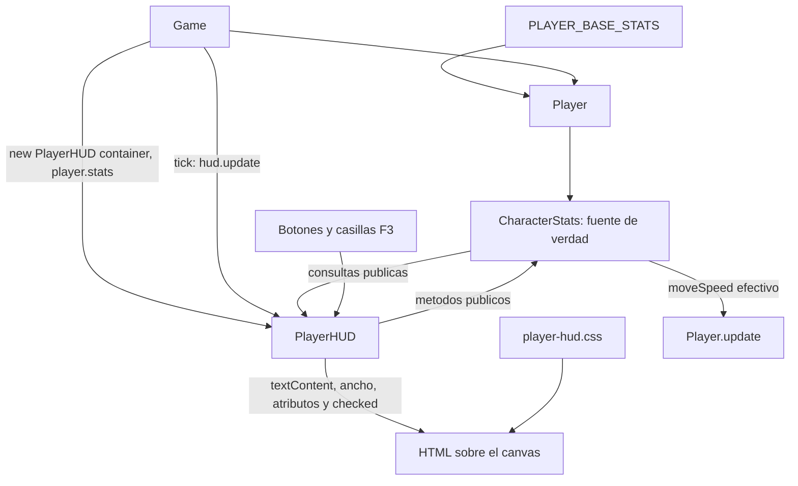

# PlayerHUD: guia para modificarlo personalmente

Esta guia describe el HUD real de la fase 3B. No usa Angular, frameworks de UI ni un segundo bucle de animacion.

## 1. Arquitectura

| Archivo | Responsabilidad |
| --- | --- |
| `src/main.ts` | Importa los estilos generales, crea `Game`, lo inicia y registra `game.dispose()` para HMR de Vite. |
| `src/core/Game.ts` | Posee un `Player`, un `PlayerController` y un `PlayerHUD`. Coordina movimiento, camara, apuntado, mundo, HUD y render. |
| `src/entities/Player.ts` | Posee `readonly stats = new CharacterStats(PLAYER_BASE_STATS)`. Su getter `speed` lee `moveSpeed` efectivo. |
| `src/core/CharacterStats.ts` | Dominio: recursos, estadisticas base/efectivas y modificadores. No conoce DOM ni Three.js. |
| `src/core/CharacterStats.types.ts` | Define `CharacterStatValues`, `StatKey` y `StatModifier`. El HUD reutiliza estos tipos, no los redefine. |
| `src/config/player.config.ts` | Define `PLAYER_BASE_STATS`, incluyendo velocidad 5.5, dano 15 y probabilidad critica 0.05. |
| `src/ui/PlayerHUD.ts` | Crea el DOM, conserva referencias, muestra estadisticas y traduce controles de depuracion a llamadas al dominio. |
| `src/ui/player-hud.css` | Colores, barras, posicion, panel, transiciones y reglas responsive. Lo importa `PlayerHUD.ts`. |
| `src/style.css` | Estilos generales, canvas, marca y pie del escenario. |
| `src/core/CharacterStats.check.ts` | Expone `runCharacterStatsChecks()` y `runPlayerHUDChecks()`, sin framework de tests. |



- **TypeScript:** clases, tipos y eventos. Vite transforma estos archivos en JavaScript.
- **HTML:** la plantilla de `PlayerHUD` esta dentro de un template literal de TypeScript. El navegador la convierte en elementos reales con `innerHTML`.
- **CSS:** pinta la interfaz; no calcula vida, energia ni mejoras.
- **Three.js:** dibuja la escena y el personaje en un canvas WebGL. El HUD es HTML superpuesto, no un objeto 3D ni un material de Three.js.

El constructor recibe la misma instancia `player.stats`, no una copia. No hay un segundo `currentHealth` dentro del HUD.

## 2. Ciclo de vida

### Construccion

En el constructor de `Game`, despues de crear el controlador:

```ts
this.hud = new PlayerHUD(container, this.player.stats)
```

`PlayerHUD` crea `root`, asigna la plantilla una sola vez y busca las referencias a barras, panel, casillas y lecturas. El mapa `readouts` agrupa los elementos por `data-value`: una misma lectura, como `health`, aparece tanto en el panel como en el HUD compacto.

Despues registra listeners, inserta `root` en `container` y ejecuta `update()` para mostrar valores desde el primer momento.

### Actualizacion

`Game.start()` ya registra `this.tick` con `renderer.setAnimationLoop`. En cada `tick`:

1. Se calcula un `deltaTime` limitado a 0.05 segundos.
2. Se ejecutan movimiento, seguimiento de camara, apuntado y actualizacion del mundo.
3. Se llama a `this.hud.update()`.
4. Se renderiza la escena con Three.js.

`PlayerHUD.update()` vuelve a consultar el dominio y modifica los nodos existentes. No vuelve a asignar `innerHTML`. `setText()` solo cambia el texto cuando ha cambiado el valor formateado; el ancho de la barra tampoco se reasigna si es igual.

Los botones y casillas llaman tambien a `update()` al terminar. Asi se ve su resultado inmediatamente, incluso antes del siguiente frame. Si otro sistema modifica estadisticas, el siguiente `Game.tick` recoge el cambio.

No se necesita `requestAnimationFrame`, `setInterval` ni otro `setAnimationLoop` en `PlayerHUD`: `Game` ya organiza el ciclo completo. La transicion de las barras la realiza CSS.

### Destruccion

`Game.dispose()` detiene el bucle y llama a `this.hud.destroy()` antes de liberar jugador y escena.

`destroy()`:

1. Cierra el panel y restaura el foco anterior si procede.
2. Marca el componente como destruido.
3. Ejecuta `events.abort()`, que retira los listeners registrados con su `signal`, incluido el listener global de F3.
4. Retira solo los dos modificadores reservados del HUD.
5. Elimina `root` y todos sus hijos del documento.

Se puede llamar dos veces sin efectos adicionales. `update()` despues de destruir no hace nada. Esto importa tambien durante HMR: no deben quedar interfaces o listeners antiguos.

## 3. Lectura del codigo

### API publica de PlayerHUD

| Miembro | Uso |
| --- | --- |
| `constructor(container, stats)` | Construye y monta el componente usando las estadisticas recibidas. |
| `update(): void` | Sincroniza recursos, valores base/efectivos y casillas desde `CharacterStats`. |
| `destroy(): void` | Retira listeners, modificadores del HUD y DOM. |

### Metodos privados importantes

- `updateResource(bar, key, current, maximum)`: calcula el porcentaje, cambia el ancho del relleno, los atributos ARIA y el texto actual/maximo.
- `setText(key, value)`: busca los nodos cacheados para `data-value` y actualiza su `textContent` si hace falta.
- `formatStat(key, value)`: usa `numberFormat`; para `criticalChance`, multiplica por 100 y agrega `%`.
- `setDebugOpen(open)`: cambia `panel.hidden` y gestiona el foco. No pausa el juego.
- `onKeyDown`: reconoce F3 y descarta repeticiones.
- `onAction`: interpreta el `data-action` del boton y llama a las APIs de recursos.
- `onModifierChange`: traduce las casillas a altas/bajas de modificadores.
- `stopPropagation`: evita que los eventos del panel sigan hacia listeners de la escena.

Los handlers son propiedades con funciones flecha. Asi conservan `this` al pasarlos como callbacks a `addEventListener`.

### Barras de recursos

En la plantilla, cada recurso tiene una etiqueta, un `<output>` y un contenedor `.hud-resource__track` con un `<span>` de relleno.

El contenedor lleva `role="progressbar"`, `aria-label`, `aria-valuemin`, `aria-valuenow` y `aria-valuemax`. Es informacion para tecnologias de asistencia, no una copia del dominio.

La proporcion se calcula como `current / maximum`, limitada a `[0, 1]`. Si el maximo es cero, la proporcion es cero: nunca se divide entre cero. El ancho resultante esta entre `0%` y `100%`.

`healthBar` y `energyBar` son referencias permanentes a esos contenedores. El primer hijo es el relleno; el texto se actualiza mediante las entradas `health` y `energy` del mapa `readouts`.

### Estilos

`import './player-hud.css'` permite que Vite incorpore el CSS al desarrollo y al build. Las clases tienen prefijo `hud-` o `player-hud` para evitar cambios accidentales en otros elementos.

`.player-hud` posiciona el conjunto en la esquina inferior izquierda, por encima del pie del escenario. Las variables `--hud-health` y `--hud-energy` determinan los colores. La tipografia sigue el estilo ya existente del juego.

El panel aparece encima del HUD en escritorio. En pantallas de hasta 600px de ancho pasa a la zona superior, con altura limitada y scroll, dejando libre la zona central. En pantallas bajas de mas de 600px pasa a la derecha. Hay una regla que desactiva transiciones cuando el usuario prefiere menos movimiento.

### F3 y aislamiento de eventos

`window` recibe `keydown` en captura. Si `event.code === 'F3'`, el HUD evita la accion del navegador y la propagacion. Solo alterna el panel si `event.repeat` es falso: mantener F3 pulsada no genera aperturas/cierres repetidos.

El panel tiene `tabindex="-1"` para poder recibir foco mediante codigo. Al abrirlo se recuerda el foco anterior; al cerrarlo se intenta restaurar.

`.player-hud` usa `pointer-events: none`: las barras no interceptan el raton. `.hud-debug` usa `pointer-events: auto`: sus controles si son interactivos. Los eventos de raton/puntero del panel no se propagan a listeners de la escena.

Los `keydown` dentro del panel no llegan a `InputManager`, pero los `keyup` si. Esto permite soltar una W que estuviera pulsada antes de entrar al panel y evita dejar movimiento atascado. No se cancela el comportamiento nativo de botones y casillas con Espacio/Enter.

Mientras el foco esta en el panel, WASD no inicia movimiento. Haz clic en la escena o cierra F3 para devolver el control al juego. El panel no es modal y el mundo no se pausa.

### Modificadores

`DEBUG_MODIFIERS` define dos entradas estables:

| Clave del control | ID reservado | Efecto |
| --- | --- | --- |
| `speed` | `hud.debug.speed-20` | `moveSpeed`, porcentaje `0.2` |
| `damage` | `hud.debug.damage-50` | `attackDamage`, porcentaje `0.5` |

`onModifierChange` consulta `stats.getModifiers()` para saber si ya existe el ID. Solo lo agrega cuando falta y solo lo retira cuando esta presente. No guarda un booleano paralelo que pueda desincronizarse.

`update()` obtiene las mejoras reales y asigna `checked` a las casillas. Si otro sistema retira un ID, la casilla lo reflejara en el siguiente frame.

No reutilices esos IDs para otro sistema. `destroy()` retira ambos porque pertenecen a la depuracion del HUD. Los modificadores ajenos permanecen intactos.

La formula sigue siendo `(base + suma plana) * (1 + suma porcentual)`. Sin otras mejoras, velocidad pasa de 5.5 a 6.6 y dano de 15 a 22.5. Retirar la mejora elimina su contribucion, no elimina otras mejoras ajenas.

### Consultas encapsuladas de CharacterStats

- `getStat(key)` devuelve el numero efectivo.
- `getBaseStat(key)` devuelve el numero base original.
- `getModifiers()` devuelve un snapshot de solo lectura: un array congelado de modificadores tambien congelados, no el `Map` interno. Para verlo actualizado hay que consultar de nuevo.
- `currentHealth` y `currentEnergy` son getters sin setters publicos.

Los controles usan `takeDamage`, `heal`, `spendEnergy` y `restoreEnergy`. Para restaurar al maximo se pasa el maximo efectivo a `heal` y `restoreEnergy`; esas APIs ya limitan el resultado. No hay asignaciones directas a los recursos.

Defensa sigue siendo un valor mostrado: `takeDamage` aun aplica dano directo. No se ha implementado una formula de combate.

## 4. Comparacion con Java y Angular

### CharacterStats como dominio Java

Piensa en una clase Java de dominio con campos privados y metodos como `takeDamage` o `spendEnergy`, que protegen invariantes. No deberias cambiar la vida desde la vista, igual que no saltarias las reglas de un objeto de dominio Java.

`StatKey` es `keyof CharacterStatValues`: el compilador solo acepta las claves declaradas. Es comparable al objetivo de un enum de nombres validos, aunque aqui es una union de cadenas derivada de una interfaz. Los tipos e interfaces de TypeScript desaparecen al compilar: no son objetos de runtime ni validadores automaticos.

### PlayerHUD como componente Angular

La plantilla HTML equivale conceptualmente a la vista de un componente. El constructor monta la vista; `update()` aplica valores; `destroy()` recuerda a `ngOnDestroy`. No son hooks de Angular: `Game` llama explicitamente a estos metodos.

Aqui no hay interpolacion `{{ valor }}`, bindings ni deteccion de cambios de Angular. `readouts`, `setText`, `style.width` y `checked` hacen esas actualizaciones directamente.

Un `HTMLElement` es una referencia al objeto que representa un nodo real del documento. Por ejemplo, `healthBar` no contiene HTML como texto: apunta a un elemento que ya esta en pantalla. Cambiar su atributo o el estilo de su hijo cambia esa misma vista, sin recrearla.

`querySelector<HTMLElement>(...)` comunica el tipo esperado al compilador. El `!` que aparece tras algunas consultas afirma que el nodo existe; no lo crea ni lo verifica en runtime. Si cambias la plantilla, conserva los selectores usados por el constructor.

### readonly y private

- `private` restringe el acceso desde TypeScript a la clase propietaria. No es el mismo mecanismo que un campo JavaScript `#privado` ni una barrera de seguridad en runtime.
- `readonly stats` impide reasignar esa referencia despues del constructor; no impide llamar a `stats.heal(20)` y modificar el objeto al que apunta.
- `readonly root` impide sustituir el elemento por otro; sus propiedades y sus hijos siguen siendo modificables.
- Los tipos `Readonly` ayudan en compilacion. `Object.freeze` es la proteccion adicional de runtime usada para las bases y los snapshots de modificadores.

## 5. Personalizacion paso a paso

### Color de vida

En `src/ui/player-hud.css`, cambia `--hud-health` dentro de `.player-hud`. La regla `.hud-resource--health .hud-resource__track > span` lo utiliza. No cambies `CharacterStats`: color y salud son responsabilidades distintas.

### Posicion

En el mismo CSS, cambia `left` y `bottom` de `.player-hud`. Para moverlo arriba, quita el anclaje inferior con `bottom: auto` y usa `top`. Revisa tambien las reglas responsive al final del archivo y deja espacio a `.identity` y `.location`, definidos en `src/style.css`.

La posicion del panel F3 tiene reglas propias: cambiar el HUD no cambia necesariamente el panel fijo de movil o el de pantallas bajas.

### Dimensiones de barras

El ancho disponible lo controla `width` de `.player-hud`, con el espacio interior de `.hud-telemetry`. La altura esta en `.hud-resource__track { height: 7px; }`.

No pongas un ancho fijo al `<span>` de relleno: `updateResource` es quien asigna el porcentaje segun las estadisticas.

### Agregar una estadistica visible

En `src/ui/PlayerHUD.ts`, agrega un elemento con `data-value` en el `<dl class="hud-attributes">` de la plantilla. Usa una clave real de `StatKey`; por ejemplo, `maxEnergy` para mostrar capacidad de reserva como numero separado.

Incluye esa clave y su etiqueta en `DEBUG_STATS`: el constructor creara su fila base/efectiva y el bucle de `update()` actualizara todos los elementos con ese `data-value`. Ajusta `grid-template-columns` en `.hud-attributes` si cambias la cantidad de columnas.

Para un dato que no sea una estadistica numerica existente, disena primero una consulta publica del dominio. No accedas a campos privados ni inventes una segunda fuente de verdad en el HUD.

### Ocultar una estadistica

Para ocultarla solo en el HUD compacto, retira su `<div>` del `dl.hud-attributes` en la plantilla. Puede seguir en `DEBUG_STATS` y en F3. Para quitar una fila de F3, retira su entrada de `DEBUG_STATS`; recuerda que ese mismo array alimenta el bucle de actualizacion.

### Formato de numeros

En `PlayerHUD.ts`, cambia las opciones de `numberFormat` para modificar la cantidad de decimales. Actualmente usa formato `es`, por eso veras `5,5`, no `5.5`. `formatStat()` maneja la conversion de critico a porcentaje; `updateResource()` compone `actual / maximo`.

No redondees ni sobrescribas el dominio para cambiar como se ve: formatea solo al presentar el valor.

### Nuevo boton F3

Agrega un `<button type="button" data-action="...">` a `.hud-debug__actions` en la plantilla. Agrega el `case` correspondiente en `onAction`, invocando una API publica de `CharacterStats`. Por ejemplo, un control de depuracion podria gastar 10 de energia con `spendEnergy(10)`.

No hace falta registrar un listener por boton: el listener de `click` esta delegado en el panel y `closest('button[data-action]')` identifica el control. `update()` ya se ejecuta al final del handler. No agregues otro bucle o timer.

### Tecla de apertura

Cambia `'F3'` en `onKeyDown`, dentro de `PlayerHUD.ts`, por el `event.code` elegido. Conserva `preventDefault`, el filtro de `repeat` y la limpieza mediante `AbortController`.

Actualiza tambien el helper `f3` de `runPlayerHUDChecks()` y esta documentacion si cambias la tecla. Evita teclas con acciones reservadas importantes del navegador.

## 6. Ejercicios sin Copilot

### Facil: colores y dimensiones

- **Archivo:** `src/ui/player-hud.css`.
- **Conceptos:** variables CSS, selectores, contenedores, porcentajes y media queries.
- **Objetivo:** elegir otros colores distinguibles para vida/energia y cambiar el ancho del HUD y la altura de barras sin mover el pie del escenario.
- **Pista:** busca `--hud-health`, `--hud-energy`, `.player-hud` y `.hud-resource__track`. El ancho proporcional del relleno debe seguir en manos de TypeScript.
- **Comprobacion:** recibe dano, cura, gasta energia y restaura; revisa escritorio y 390px de ancho. Las barras deben seguir mostrando 0-100%, sin texto cortado.

### Medio: indicador visual de probabilidad critica

- **Archivos:** `src/ui/PlayerHUD.ts` y `src/ui/player-hud.css`.
- **Conceptos:** lectura tipada con `getStat`, referencias DOM, formato porcentaje y representacion visual sin duplicar datos.
- **Objetivo:** mostrar el critico efectivo tambien fuera del panel F3, con un pequeno indicador proporcional.
- **Pistas:** `DEBUG_STATS` ya contiene `criticalChance`; observa `formatStat` y el uso de `data-value`. Su valor de dominio es 0.05, no 5. Crea el nodo una vez y conserva su referencia. No necesitas otro tipo de estadisticas.
- **Comprobacion:** al inicio debe indicar 5%. Aplica un modificador temporal a esa estadistica en una instancia de prueba, actualiza el HUD y retira el modificador. El indicador debe concordar con F3, respetar 0-100% y regresar al valor anterior.

### Avanzado: lista visual de modificadores activos

- **Archivos:** `src/ui/PlayerHUD.ts` y `src/ui/player-hud.css`; amplia `src/core/CharacterStats.check.ts` para verificarlo.
- **Conceptos:** encapsulacion, snapshots, identificadores estables y sincronizacion incremental del DOM.
- **Objetivo:** mostrar cada modificador activo con su ID, estadistica y aportes plano/porcentual, sin acceder al `Map` privado de `CharacterStats`.
- **Pistas:** la API real es `getModifiers()`. Consulta de nuevo al actualizar: el snapshot anterior no cambia. Puedes relacionar cada nodo con un ID; agrega/elimina solo las entradas necesarias. Usa `textContent`, no HTML generado a partir de IDs externos. Un mapa de nodos es estado de vista, no una copia del estado de dominio.
- **Comprobacion:** activa las dos mejoras F3, verifica dos IDs distintos y ningun duplicado; retira una y comprueba que la otra permanece. Agrega un modificador ajeno al HUD en una instancia de prueba para confirmar que no estas mostrando solo las dos casillas conocidas. No debe ser posible mutar el dominio cambiando el snapshot.

No se incluyen soluciones completas: primero intenta seguir las referencias y explicar de donde sale cada valor que muestras.

## 7. Validacion y limites de esta fase

Desde la carpeta del proyecto:

```sh
npm run build
npm run dev
```

Abre la URL de Vite. Pulsa F3, prueba todos los controles, activa/desactiva las mejoras y vuelve al canvas para comprobar WASD y apuntado. En movil el panel tiene scroll interno. Mantener F3 pulsada no debe alternarlo repetidamente.

Sin mantener teclas pulsadas, estas funciones pueden ejecutarse en la consola del navegador:

```js
const checks = await import('/src/core/CharacterStats.check.ts')
checks.runCharacterStatsChecks()
checks.runPlayerHUDChecks()
```

La segunda funcion usa un contenedor temporal fuera de pantalla y lo destruye al terminar. Comprueba recursos, nodos reutilizados, F3, repeticiones, mejoras sin acumulacion, movimiento con mejora, eventos y limpieza. Sus eventos F3 tambien alcanzan el HUD de la partida; las alternancias se hacen por pares para restaurar el estado inicial en una ejecucion correcta.

Validado en esta implementacion: build correcto, 115 comprobaciones de estadisticas y 27 del HUD. Se probaron controles en navegador, capturas de escritorio/movil y limites de distribucion a 320x568, 390x844, 844x390 y 1440x900. Se verifico el enlace de `Game.tick` con frames controlados, incluyendo movimiento y pixeles no vacios de WebGL; esto no equivale a certificar animacion continua con la pestana oculta.

Vite advierte del bundle mayor de 500 kB. No hay framework ni script de tests; las funciones anteriores son comprobaciones manuales ejecutables. No se han anadido dependencias, disparos, enemigos, habilidades, cooldowns, inventario ni regeneracion.

## Antes de modificarlo por tu cuenta

Deberias poder explicar estas cinco ideas:

1. `CharacterStats` decide los valores; el HUD solo consulta y solicita operaciones publicas.
2. El HTML se crea una vez; los nodos referenciados se actualizan desde el bucle de `Game`.
3. Los porcentajes de dominio, el formato de texto y el ancho visual son conceptos distintos.
4. Los eventos de una interfaz superpuesta deben aislarse sin perder las liberaciones de teclas.
5. Cada listener y modificador creado por el HUD tiene una limpieza correspondiente en `destroy()`.